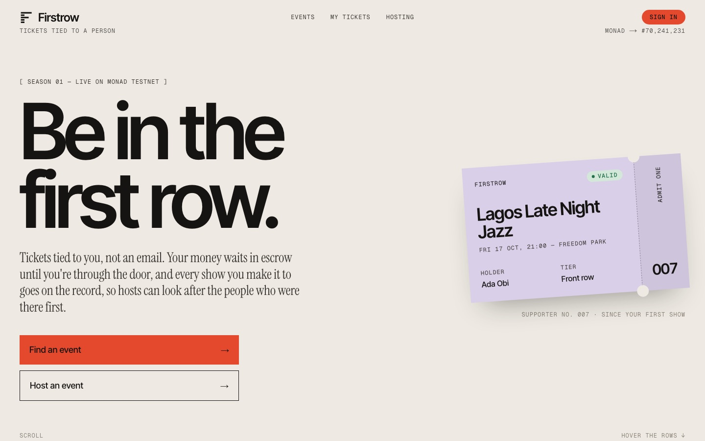
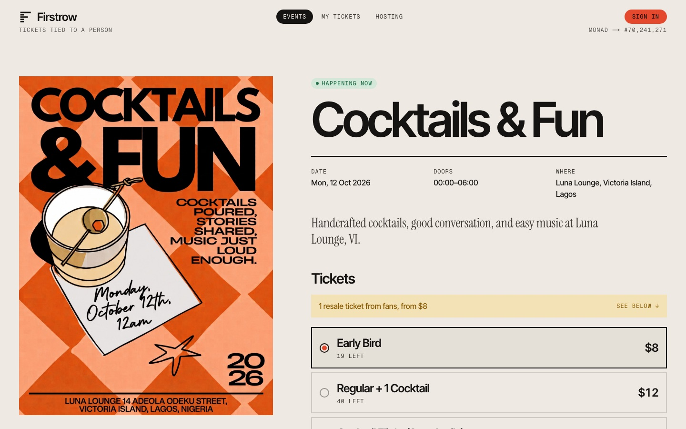
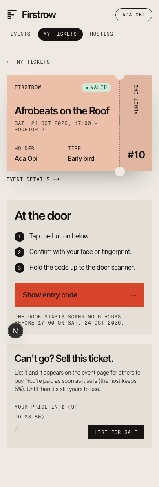
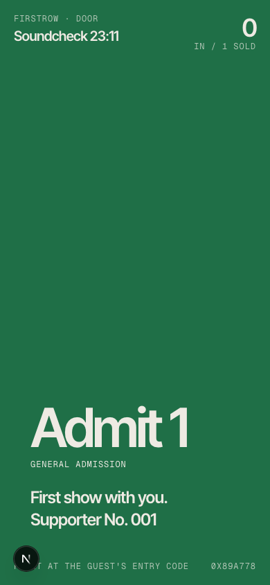

# Firstrow

**Tickets tied to a person, not an email.** Fans sign in with a passkey, pay in dollars, and their money waits in escrow until they walk through the door. Every check-in goes on the record, so hosts can see who actually shows up and give those people first access next time.

Live on Monad testnet: **[firstrow.site](https://www.firstrow.site)**

Built for Monad Metropolis 2026, Track 03: Social, Attention & Culture.



## The problem

Independent events run on trust that nobody can check.

- A fan pays the organiser up front. If the event is cancelled or never happens, getting the money back is slow or impossible.
- Scalpers buy early and resell at a markup, and the host and the real fans both lose.
- The people who show up to a host's first small shows get nothing for it. The record of who was there lives in a ticketing company's database, if it exists at all.

## What Firstrow does

1. **A host publishes an event.** Name, venue, poster, schedule and ticket tiers. Dates, prices and resale rules are locked from that moment.
2. **A fan buys with a passkey.** No password, no seed phrase, no app, no gas. The dollars go into a contract, not to the host.
3. **At the door, the fan shows a code** that only their passkey can make. A door phone scans it and the check-in settles in under a second.
4. **The host is paid per person who walks in.** Each ticket's price becomes withdrawable when its holder is checked in.
5. **If it goes wrong, fans refund themselves.** A cancelled event, or a ticket that was never scanned, can be claimed back from the contract with no support ticket.
6. **Resale is capped.** Tickets can only change hands through Firstrow, at a price the host allows (face value by default), with a cut back to the host.
7. **Showing up counts.** The first person a host checks in is their supporter No. 001, for good. Hosts can open a presale that only returning fans can buy in.

| | |
|---|---|
|  |  |
|  |  |

## Why Monad

- **Speed at the door.** A check-in is a transaction. With ~400 ms blocks and sub-second finality, door staff never wait on a confirmation and there is nothing to reconcile afterwards.
- **Fees small enough to give away.** A relayed purchase or check-in costs about 0.026 MON (measured on testnet), so Firstrow pays the network fee for every fan, host and door phone. That makes $5 tickets and free events practical.
- **Mera passkeys.** A fan's account is derived from a passkey with [Mera](https://docs.monad.xyz/guides/mera), so onboarding is one fingerprint.
- **AUSD.** Agora's dollar supports signed transfers (EIP-3009), so a purchase is a single signature with no approval step.

## How it works

```
 Fan / host / door phone                 Firstrow relayer                    Monad
 ───────────────────────                 ────────────────                    ─────
 passkey (Mera) ──► signs a request ──►  checks the signature,  ──►  ERC2771Forwarder
                                         simulates, pays the fee              │
                                                                              ▼
 passkey ──► signs an AUSD payment (EIP-3009) ───────────────────────►   Firstrow.sol
                                                                          escrow · tickets
                                                                          check-ins · resale
                                                                              │ events
                                                                              ▼
 Web app  ◄────────────  GraphQL  ◄────────────  Envio HyperIndex  ◄──────────┘
 (fan record, supporter lists, live totals)
```

- **`contracts/`** Foundry project. `Firstrow.sol` is one contract with no owner, no admin function, no pause and no upgrade path.
- **`web/`** Next.js app: events, checkout, tickets with a live entry code, hosting tools, door scanner, and the relayer API route.
- **`indexer/`** Envio HyperIndex: turns check-ins into attendance history, supporter standings and totals.

### The contract

Every ticket's price ends up with exactly one party: the host (the holder checked in, or never claimed a refund), the buyer (refunded), or a reseller (resale price minus the host's cut). All accounting is per event.

| Risk | How the contract handles it |
|---|---|
| A host fakes check-ins to unlock the money | A check-in needs a signature from the ticket holder's own key |
| A host collects signatures in advance | A signature is only accepted within 10 minutes of its deadline, inside the check-in window |
| A screenshot of the code is passed around | The code expires in minutes and a ticket checks in once |
| Someone reuses a fan's payment signature | The contract only pulls AUSD from the account making the call |
| The relayer misbehaves | It can only submit requests users signed. It cannot forge one or move funds; the worst it can do is refuse to relay |
| A host changes the date or price after selling | Schedule, prices and resale rules are immutable. Only display details (description, poster) can be edited |
| Scalping | Tickets are not transferable. Resale goes through the contract at a capped price |
| A door phone is lost | Its key can only submit holder-signed check-ins for one event |

### Passkeys, and one passkey for many keys

Mera is the entire account layer. There is no seed phrase, no browser extension and no custody backend.

- **The account** is derived from the passkey's PRF output the way Mera documents it, so it can be exported as a standard 24-word recovery phrase.
- **The door key.** For each event, the app asks the same passkey for a second PRF output with a different salt (`firstrow.door.v1:<chain>:<contract>:<eventId>`). That gives an unrelated secret, which becomes a key that can sign check-ins for that one event and nothing else. Its address is registered when the ticket is bought. At the door the wallet key is never loaded: the fan's fingerprint unlocks only the key for that night.

Code: [`web/src/lib/passkey.ts`](web/src/lib/passkey.ts).

### The indexer

The supporter registry is only useful if it can be read. Envio indexes the contract's events into fans, hosts, supporter standings, a check-in timeline and totals. The app uses it for the public fan record (`/fans/<address>`), the host's supporter list and the live totals on the home page. If the indexer is unreachable, the fan record falls back to reading the contract directly.

Code: [`indexer/`](indexer/), client in [`web/src/lib/indexer.ts`](web/src/lib/indexer.ts).

## Deployments

| Network | Contract | Address |
|---|---|---|
| Monad testnet (10143) | Firstrow | [`0xa0701766CEf8F7F42D919347A0227f4aD3ef6F58`](https://testnet.monadscan.com/address/0xa0701766CEf8F7F42D919347A0227f4aD3ef6F58) |
| Monad testnet (10143) | ERC2771Forwarder | [`0x8071155E3c3621FD5fe9Eae19C79D5bA9a2a70Ac`](https://testnet.monadscan.com/address/0x8071155E3c3621FD5fe9Eae19C79D5bA9a2a70Ac) |

Both are verified on Sourcify. The app runs on testnet so anyone can try it with free test dollars.

## Testing

- **Contract:** 52 tests. Unit tests for every rule and revert, fuzz tests on prices and timing (1,000 runs each), and invariant tests over random sequences of every action (16,384 calls) checking that the contract always holds exactly what it owes. 100% line coverage of `Firstrow.sol`. One test buys a ticket with real testnet AUSD on a fork.
- **End to end:** two scripts drive the real UI in Chrome with virtual passkeys against Monad testnet. One covers hosting, pairing a door phone, buying, and a door scan through a fake camera fed with the fan's code. The other covers listing, buying a resale ticket, cancelling and refunding.
- **Indexer:** 3 tests over simulated events.

```
cd contracts && forge test
cd indexer && pnpm test                      # needs Node 22.15+
cd web && pnpm dev --port 3200
node web/scripts/e2e-ui.mjs                  # with the dev server running
node web/scripts/e2e-resale.mjs
```

## Run it locally

Requirements: [Foundry](https://getfoundry.sh) 1.8+, Node 22+, pnpm.

```
git clone --recurse-submodules https://github.com/Abdul-Jimoh/firstrow.git
cd firstrow/web
pnpm install
cp .env.example .env.local
pnpm dev
```

In `web/.env.local`:

| Variable | What it is |
|---|---|
| `NEXT_PUBLIC_CHAIN` | `monadTestnet` |
| `RELAYER_PRIVATE_KEY` | A key holding a little testnet MON. It pays network fees for users |
| `NEXT_PUBLIC_INDEXER_URL` | Optional. Envio GraphQL endpoint |
| `BLOB_READ_WRITE_TOKEN` | Optional. Vercel Blob token for poster uploads and display names |

Passkeys need a provider that supports the WebAuthn PRF extension (iCloud Keychain, Google Password Manager, 1Password). On desktop Chrome, save the passkey to Google Password Manager.

To deploy the contracts: `cd contracts && forge script script/Deploy.s.sol --rpc-url monad_testnet --account <keystore> --broadcast`.

## Bounties

- **Best Mera-Powered UX.** Mera is the only account layer, for fans, hosts and door phones alike. Nobody sees a seed phrase, an extension, a wallet prompt or a gas fee.
- **Mera: One Passkey, Many Keys.** The per-event door key described above: a non-wallet key derived from the same passkey with its own PRF salt.
- **Best Use of Envio.** HyperIndex powers the supporter registry: fan records, host supporter lists and live totals.

## Status and limits

- The app runs on Monad testnet with test dollars. On mainnet, fans would fund their account by sending AUSD to it; a card on-ramp is the next step for people who don't hold crypto.
- The relayer is run by Firstrow. It cannot move funds or forge actions, but if it is down, nothing gets relayed. Every contract function can also be called directly by an account that holds MON.
- Posters and display names are stored off-chain (Vercel Blob). Everything about money, tickets and attendance is on-chain.
- A fan who simply doesn't attend can reclaim their money in the week after the event. Hosts are guaranteed revenue only for guests who came through the door.
- Door phones need an internet connection.

## Built with

Solidity, Foundry, OpenZeppelin, Next.js, viem, Mera, Envio HyperIndex, GSAP, Lenis.

Built with AI assistance (Claude Code).

## License

MIT
